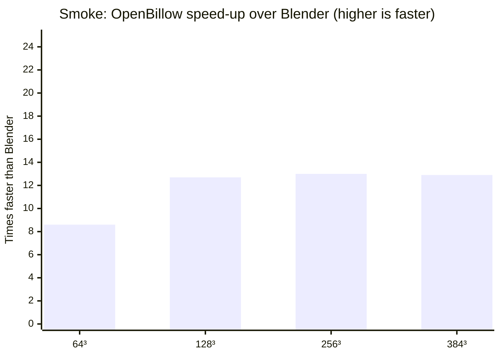
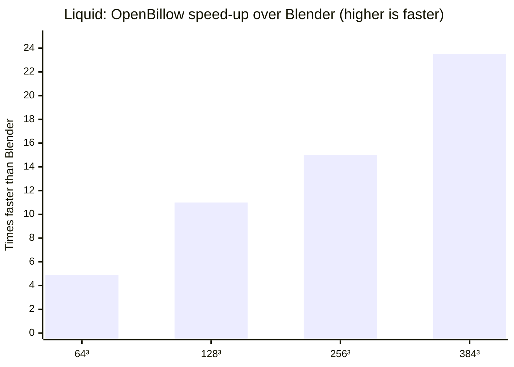

# OpenBillow

Website, buying and support: https://pipelineflow.co.uk/openbillow/

A GPU smoke solver for Blender. It follows Blender's Mantaflow gas algorithm,
runs on NVIDIA GPUs through [Warp](https://github.com/NVIDIA/warp), and writes
OpenVDB sequences that Blender loads as Volume objects.

**Status: v0.5.2 Early Access, smoke, fire, noise/upres and liquid (FLIP/APIC) with spray, foam and bubbles.**
The solver matches Mantaflow's reference scenes to within a few percent, and the Blender add-on
(panels, bake, resume, cancel, presets, support, updates) works. Changes are in [CHANGELOG.md](CHANGELOG.md).


## Install (Blender extension)

One small zip (about 70 KB) works on Windows and Linux. macOS is out: Warp needs CUDA.
Build it with `tools/build_extension.py`.

1. In Blender: Edit > Preferences > Get Extensions > the arrow menu (top right)
   > **Install from Disk…**, then choose `openbillow-<version>.zip`.
2. Enable the add-on and open the Physics tab of a mesh object.
3. First use only: click **Install GPU Engine** in the OpenBillow panel. It downloads
   NVIDIA Warp (about 105 MB) from PyPI into the add-on's folder. Needs internet.
   On a machine without internet, run
   `<blender python> -m pip install --target <extension folder>/deps --no-deps warp-lang==1.18.0`
   elsewhere and copy the folder over.


An NVIDIA GPU with a recent driver is required (v1 is CUDA only). The Windows
install path has not been run on Windows yet.

## Using the add-on

1. **Domain.** Select a mesh (a box), open the Physics tab, and click **Domain**
   in the OpenBillow panel. Smoke is simulated inside this box.
2. **Flow.** Select another mesh and click **Flow**. It emits smoke:
   *Density*, *Temperature*, *Surface Emission* (how far from the surface smoke
   is added), *Volume Emission*, and *Is Planar* for flat meshes.

3. **Obstacle** (optional). Select a mesh and click **Obstacle**. Smoke flows
   around it and is pushed by it when it moves. *Thickness* and *Is Planar*
   work as for Flow. Obstacles can be animated (keyframes, parenting,
   constraints; not mesh deformation). A moving obstacle needs about a third
   more VRAM, which the estimate does not show yet.
4. **Domain settings.**
   - *Resolution Divisions*: cells along the longest side. The line below it
     shows the grid shape and the estimated VRAM; it turns red above your limit.
   - *Scene Frame Range*, or your own *Start* / *End*.
   - *Cache*: bake folder. Empty uses the *Cache Root* from the add-on preferences
     (empty by default, which means `//openbillow_cache` next to the .blend, one
     folder per domain).
   - *Physics* sub-panel: gravity, density and heat buoyancy, vorticity, smoke
     dissolve, CFL number and substeps, speed. Same meaning as Blender's gas
     settings.
   - *Border Collisions*: which domain faces act as walls (default: all open).
   - *Quality* (new domains default to High Quality): *Classic* matches Blender's solver
     and is fastest. *High Quality* keeps more swirl and fine detail at the same
     resolution (about 1.7x the time per smoke step, about 10% more memory) and, for
     liquids, a cleaner splash surface. Liquids also get *Surface Tension* (High Quality
     only; slower bakes) and a *High Quality* Mesh Generator (flatter surfaces, thin
     splash sheets, fewer blobby drops) next to Blender's *Final* and *Fast*.

5. **Bake.** Press **Bake**. Progress, ETA, peak VRAM and seconds per frame show
   in the panel. When it finishes, a Volume object `<Domain>_OpenBillow` is added,
   showing the VDB sequence.
   - **Cancel** stops the bake after a few seconds. **Resume** continues from
     the last checkpoint (greyed out until the process has exited).
   - **Free Bake** deletes the baked files and the Volume object.
   - **Refresh VDB on Bake** (under Cache, on by default) makes Blender reload the
     baked files when a bake ends, so baking again over old frames shows the new result.


6. **Preferences** (Edit > Preferences > Add-ons > OpenBillow): *Cache Root*,
   *Device* (*Auto*: the graphics card, or the CPU when the bake doesn't fit in free
   graphics memory; *GPU*: always the card, bakes that don't fit are refused; *CPU*:
   always the CPU, much slower but uses system RAM), *GPU* (a Warp device such as
   `cuda:0`; empty is the default card), and *VRAM Limit (MB)* (in *GPU* mode, bakes
   estimated above it are refused; 0 means detected total minus 1 GB).
7. **Presets** (licensed; Preferences > *Presets and materials*). Enter your licence
   key and email, press *Download*, then pick a look (campfire, explosion, honey ...) from
   the *Presets* menu in the domain panel. Resolution stays as you set it.
8. **Support** (Preferences > *Send support request*). Describe the problem and press
   *Send*. You see exactly what will be sent first (GPU, versions, the end of the bake log,
   recent Blender errors; home folders are replaced by `~`). Nothing is sent unless
   Blender's online access is on and you press Send. *Save diagnostics to file* is the
   offline option.
9. **Updates** (Preferences > *Updates*). *Check for Updates* looks for a newer version
   (once per session automatically when online access is on), then *Download* and *Install*;
   restart Blender afterwards. Only your version and system type are sent.

Every setting has a plain-language tooltip: hover over it.

If a bake needs more VRAM than you have, lower *Resolution Divisions*. The
estimate is shown before you bake.

## Fire

Set a flow's type to *Fire* or *Fire + Smoke*, then open the domain's **Fire** panel.

**Fire Model**
- *Blender*: matches Blender's own fire (soft, blobby flames). Pick it when a bake must match
  a Blender scene.
- *Combustion* (recommended for new work): fuel burns only when hot enough, gives off heat,
  cools and expands. You get separate tongues and sharper tips. Slightly more memory.
  The Campfire and Explosion presets use it.

**Controls (both models)**
- *Reaction Speed*: how fast fuel burns. Higher gives shorter, quicker flames.
- *Smoke*: how much smoke the flames make (0 is clean flame).
- *Vorticity*: swirl in the flames. *Minimum / Maximum*: ignition and peak temperature.

**Combustion controls**
- *Heat Release*: heat per bit of burning fuel. Higher is hotter and brighter.
- *Cooling*, *Radiative Cooling*: how fast hot gas cools. Higher gives shorter flames with
  clearer tips; radiative keeps cores from running away.
- *Expansion*: how much gas swells as it burns. A little makes flames lively; above 1 they
  balloon sideways.
- *Flame Temperature*, *Air Temperature* (Kelvin): the range written to the `temperature` grid.
- *Disturbance* (*Size*, *Rate*): random pushes that break the flame into tongues.
  *Shredding* tears the flame edge (subtle; 0 is off).

**Tips**
- Cell size sets flame detail. A campfire wants cells of a few millimetres to a centimetre.
- Start from the Campfire preset, then change *Cooling* (flame height) and *Disturbance*
  (tongue size) first.
- *High Resolution* (noise) adds fine detail; with Combustion it still uses Blender's burn on
  the fine grid.
- Render with the *Combustion* material (Blackbody colour from `temperature`); the `flame`
  grid still works with Blender-style materials.

## VDB grids

Each frame's `.vdb` holds these grids (half float, world-space transform):

- `density`: smoke density (liquid: `phi`, a level set in metres, negative inside).
- `temperature`: **normalised**, not Kelvin. 0 is ambient; a flow's *Temperature*
  value is the source level, and the heat decays with cooling. Use it as a relative
  heat for colour ramps or Blackbody (scale it to taste).
- `velocity`: **metres per second, cell-centred** (the average of each cell's two
  faces), world axes. Blender's volume motion blur reads it as is. Multiply by the
  frame rate to get metres per frame; the solver's internal staggered grid is not written.
  With the *Combustion* fire model it is instead **Kelvin** (*Air Temperature* to
  *Flame Temperature*) where there is heat, and 0 elsewhere; feed it straight to a Blackbody shader.
- `flame` (fire only).

## Setup (development)

Requires Blender 4.5 or later (tested on 4.5, 5.1, 5.2, 5.3) and an NVIDIA GPU.
Earlier builds (2.93–4.2) lack Blender's `openvdb` Python module, which the VDB
writer needs. Install Warp into `deps/` using
Blender's bundled Python:

```sh
<blender>/5.2/python/bin/python3.13 -m pip install --target deps --no-deps -r requirements.txt
```

## Running

From the project root:

```sh
<blender>/5.2/python/bin/python3.13 -I tests/test_pressure.py
<blender>/5.2/python/bin/python3.13 -I tests/run_plume.py 64 60 out/plume
```

The second command writes `out/plume/fluid_data_NNNN.vdb` per frame.

## Speed





| ms/frame | Res | Blender | OpenBillow | Speed-up |
|---|---|---|---|---|
| Smoke plume | 64³ | 30 | 3.5 | 8.6× |
| Smoke plume | 128³ | 135 | 10.6 | 12.7× |
| Smoke plume | 256³ | 1255 | 96 | 13× |
| Smoke plume | 384³ | 5860 | 455 | 12.9× |
| Liquid dam | 64³ | 85 | 17 | 4.9× |
| Liquid dam | 128³ | 665 | 60 | 11× |
| Liquid dam | 256³ | 6455 | 420 | 15× |
| Liquid dam | 384³ | 28200 | 1201 | 23.5× |

Same scenes, same machine, Blender 5.2 (CPU) vs OpenBillow (NVIDIA GPU), 20 frames, single runs. OpenBillow timings exclude writing the VDB files and a one-off ~25 s kernel compile per machine. OpenBillow liquid runs with its default improvements (e.g. volume correction); Blender's does not.

## First bake on a machine is slow

The first bake on a machine spends about 25 s on frame 1 while Warp compiles
the solver's GPU kernels. The add-on's progress stays at frame 0 meanwhile;
the bake has not hung. Warp caches the compiled kernels, so later bakes start
at once. It compiles again after a Warp update, an OpenBillow update that changes
the kernels, or if the cache is deleted.

The cache is in `~/.cache/warp/<warp version>/` on Linux and
`%LOCALAPPDATA%\NVIDIA\warp\Cache\<warp version>\` on Windows (about 20 MB).
Set `WARP_CACHE_PATH` to put it elsewhere.

## Baking on the farm

The solver runs without `bpy`, so a Flamenco task can run it straight from a
bake folder (made by the add-on's Bake, or `addon/export.py`) on the share.
Blender 5.1's bundled Python works (it includes `openvdb`); Warp is picked up
from `deps/` in the project root.

```sh
/home/andre/Blender-5.1/5.1/python/bin/python3.13 -I openbillow_bake.py bake <bake_folder> [--resume] [--frame-end N]
```

Use a command job (not `simple-blender-render`) with one task per bake. A bake
is one sequential process: the frames depend on each other, so it cannot be
split across workers. Add `--resume` to continue after a requeue; it restarts
from the latest checkpoint. Only one bake may use a folder at a time. Check
`status.json` and `bake.log` in the folder. Each worker compiles Warp's kernels
on its first bake (see above), so expect frame 1 to take about 25 s there.

## Layout

- `openbillow/` – the solver (no `bpy`), with GPU code behind `openbillow/backend/`.
- `tests/` – tests and comparison scripts.
- `reference/` – Blender and Mantaflow source files used as the reference, plus
  bake and comparison scripts. See `reference/SOURCE.txt`.

## Licence

GPL-3.0-or-later (see [LICENSE](LICENSE)). Files copied from Blender and
Mantaflow keep their original licence headers (GPL-2.0-or-later and
Apache-2.0). The add-on is free. The preset pack and the in-add-on support are a
paid option (see Presets and Support above); the pack has its own licence.
